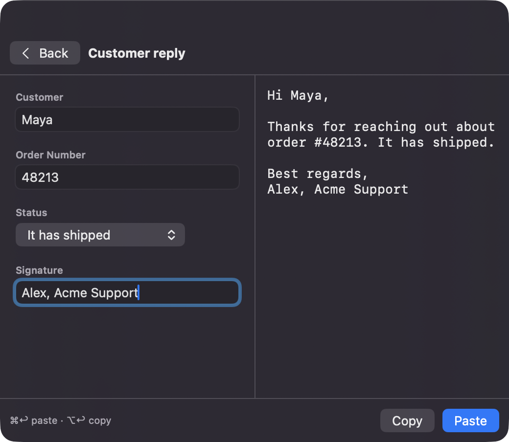
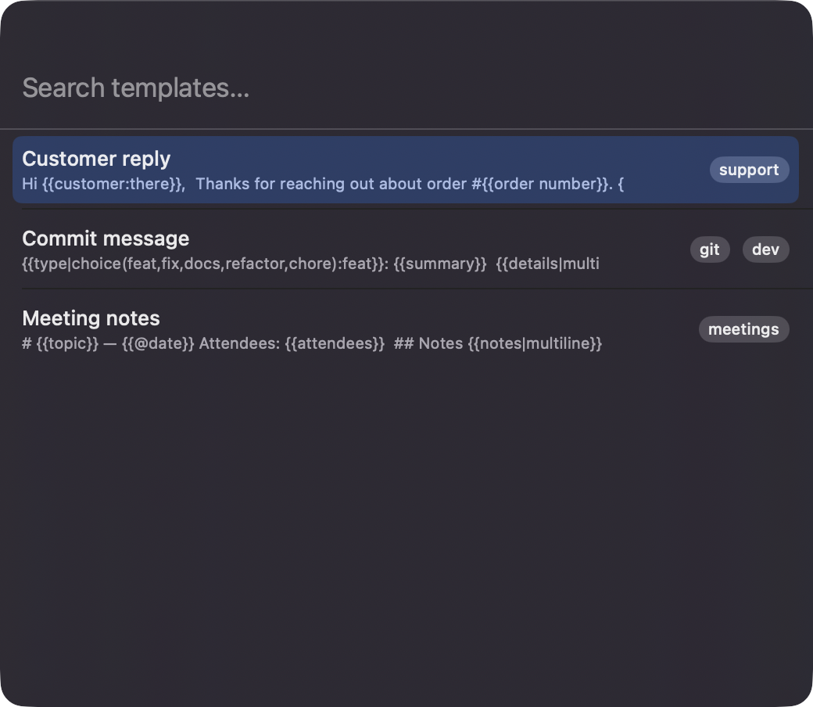
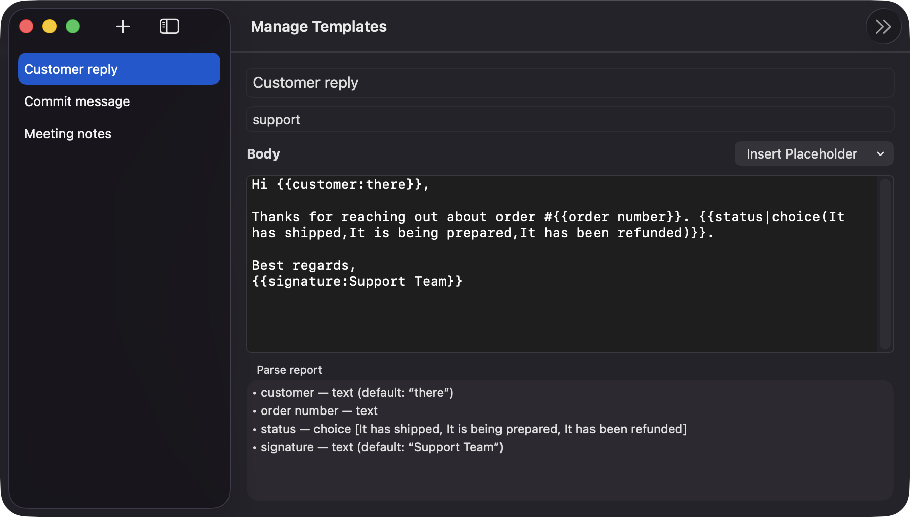
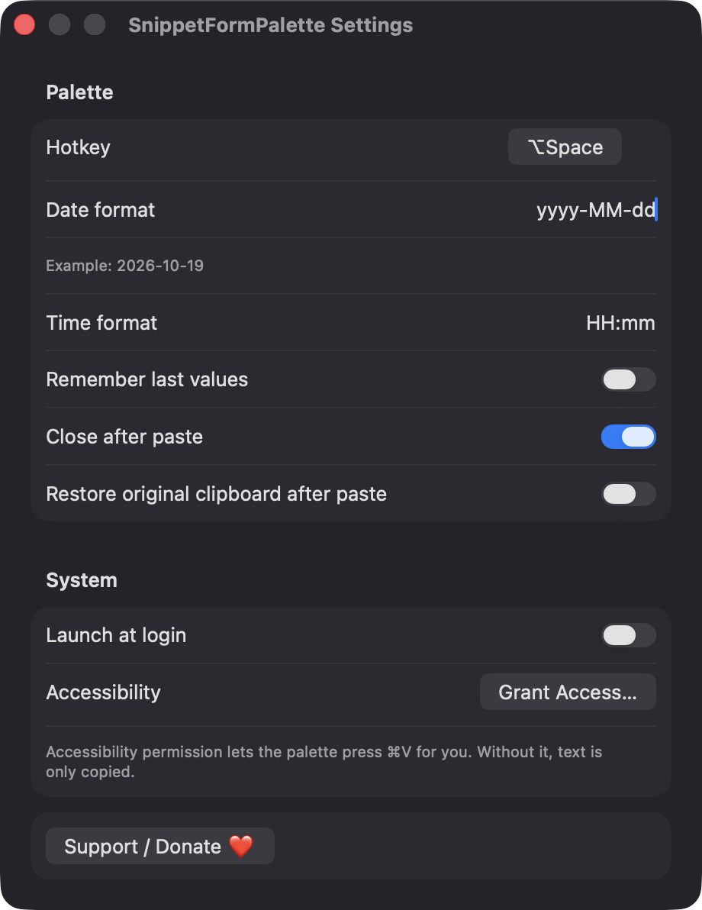

# SnippetFormPalette

**🌐 Website:** [turhe123.github.io/snippet-form-palette](https://turhe123.github.io/snippet-form-palette/)

Summon a snippet palette by hotkey, fill in a small form of variables, and paste the finished text.

> 🆓 A free, open-source **Typinator alternative** for macOS 14+. Native Swift, no accounts, no subscriptions, MIT licensed.


## Why

SnippetFormPalette is a free, open-source, 100% native, backend-free alternative to paid utilities in the *Menu Bar Utility* category. It was inspired by the fill-in fields of Typinator ($29.99/year), but focuses on one thing: an explicit palette for templates that need variables, such as customer replies, meeting notes, or commit messages. There is no account, no server, and no network access. Your templates stay on your Mac.

## Features

- **Global hotkey palette**: a centered floating 520×420 panel, opened with Option+Space by default. The hotkey can be re-recorded in Settings.
- **Menu bar app**: Open Palette, Manage Templates, Settings, Support, and Quit. There is no Dock icon.
- **Searchable template list**: filter by typing and navigate with the arrow keys. Templates can carry tags and are sorted by most recent use.
- **Dynamic form with live preview**: one input per placeholder on the left and the rendered text on the right.
- **Placeholder syntax** (`{{ }}`):
  - `{{name}}`: text input
  - `{{name:default}}`: text with a default value
  - `{{notes|multiline}}`: multi-line text
  - `{{due|date(+3)}}`: date picker with a day offset
  - `{{type|choice(A,B,C):B}}`: pick from a list, with an optional default
- **Built-in variables** that need no input: `{{@date}}`, `{{@date(-1)}}`, `{{@time}}`, `{{@clipboard}}`. Date and time formats are configurable.
- **Paste or copy**: ⌘↩ pastes into the previously active app and ⌥↩ only copies.
- **Optional clipboard restore** after pasting.
- **Template manager**: a list and editor with title, tags, body, an *Insert Placeholder* menu, and a parse report of detected fields and problems.
- **Forgiving parsing**: unclosed or nested braces, unknown types, and choices without options are reported in the parse report and fall back to literal text or a text input. Duplicate placeholder names share one input.
- **Required-field checks**: empty fields without a default are highlighted and paste/copy is disabled until they are filled.
- **Import / export** of templates as JSON, plus three example templates for an empty library.
- **Settings**: hotkey, date format, time format, remember last values, close after paste, restore clipboard, and launch at login.

## Screenshots

<p align="center"></p>

<p align="center"><em>Fill in a template&#x27;s fields on the left and watch the finished text render live on the right, then press ⌘↩ to paste it.</em></p>

<p align="center"></p>

<p align="center"><em>Press Option+Space to open a floating palette with your templates, sorted by most recent use and labeled with tags.</em></p>

<p align="center"></p>

<p align="center"><em>Edit templates in the manager, which has an Insert Placeholder menu and a parse report of the fields it detects.</em></p>

<p align="center"></p>

<p align="center"><em>Settings let you change the hotkey, date and time formats, and paste behavior, and turn on launch at login.</em></p>

## Install

1. Download `SnippetFormPalette-macOS.zip` from the [latest release](https://github.com/turhe123/snippet-form-palette/releases/latest).
2. Unzip it and move `SnippetFormPalette.app` to `/Applications`.
3. Because the app is open source and not notarized, clear the quarantine flag:

   ```bash
   xattr -cr /Applications/SnippetFormPalette.app
   ```

4. Right-click the app and choose **Open** the first time you launch it.

## Build from source

Requires macOS 14+ and Xcode with Swift 5.9 or newer.

```bash
brew install xcodegen
xcodegen generate
xcodebuild -project SnippetFormPalette.xcodeproj -scheme SnippetFormPalette -configuration Release -derivedDataPath ./build build
```

The app is produced at `build/Build/Products/Release/SnippetFormPalette.app`.

## Permissions

- **Accessibility**: needed to press ⌘V in the app you were using. The app asks for it from Settings via the system prompt. Without it, the text is only copied to the clipboard and a notice is shown.
- **Login item**: the *Launch at login* toggle registers the app with macOS (`SMAppService`). It does not use a permission prompt.

The app does **not** request Screen Recording, Microphone, Camera, Contacts, or network access. Templates are stored as JSON in `~/Library/Application Support/SnippetFormPalette/templates.json`, and settings in UserDefaults.

## Built with AI

SnippetFormPalette was written by [Claude Code](https://claude.com/claude-code) inside an automated pipeline, from a plain-English spec. No code, binaries or assets from any commercial app were used; it is a clean-room reimplementation of a feature set, not a copy.

What that means in practice:

- The full source is in this repo under the MIT license. Read it before you run it.
- No network calls, no analytics, no third-party dependencies. Only Apple frameworks.
- Ad-hoc signed and not notarized, which is why Gatekeeper warns on first launch.
- It has had less human review than a hand-written app. Bug reports and pull requests are welcome.

## Support ❤️

If SnippetFormPalette saves you time, you can support its development:

[Support Or (Leo) Davidai ❤️](https://ko-fi.com/leodavidai)

The app also has a **Support / Donate ❤️** button in its menu and Settings.

## More free Mac apps

SnippetFormPalette is one of [60 free, open-source Mac utilities](https://github.com/turhe123/mac-apps) built the same way: native Swift, no accounts, no telemetry. Browse the full gallery at [turhe123.github.io/mac-apps](https://turhe123.github.io/mac-apps/).

## License

MIT © Or Davidai Bachar
